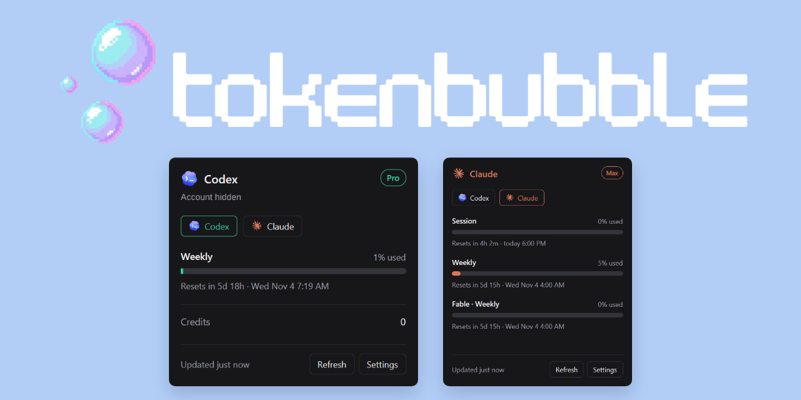
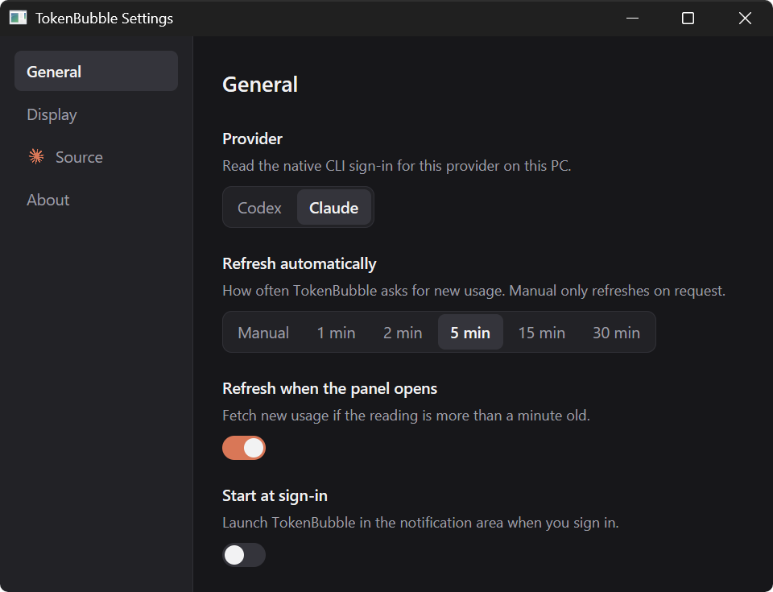
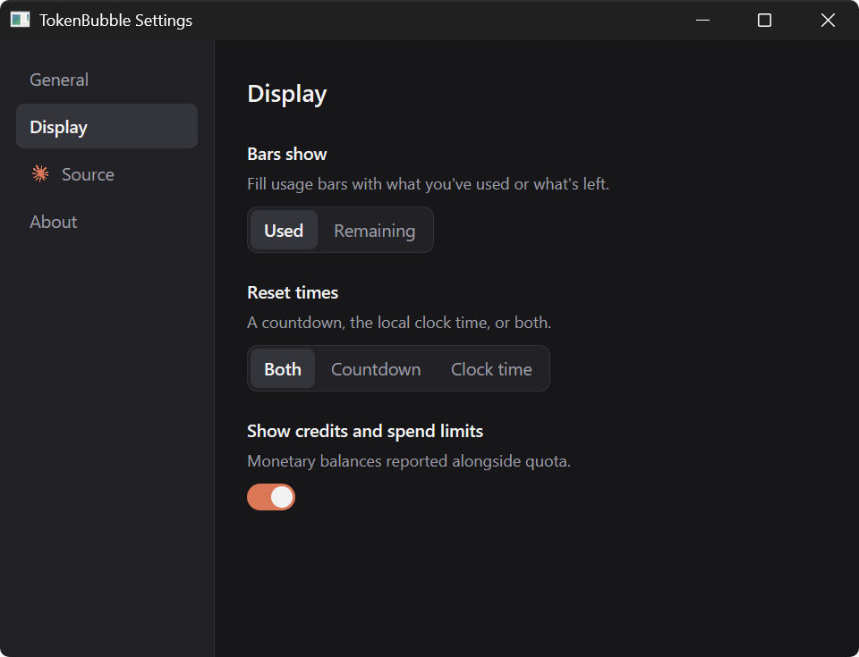
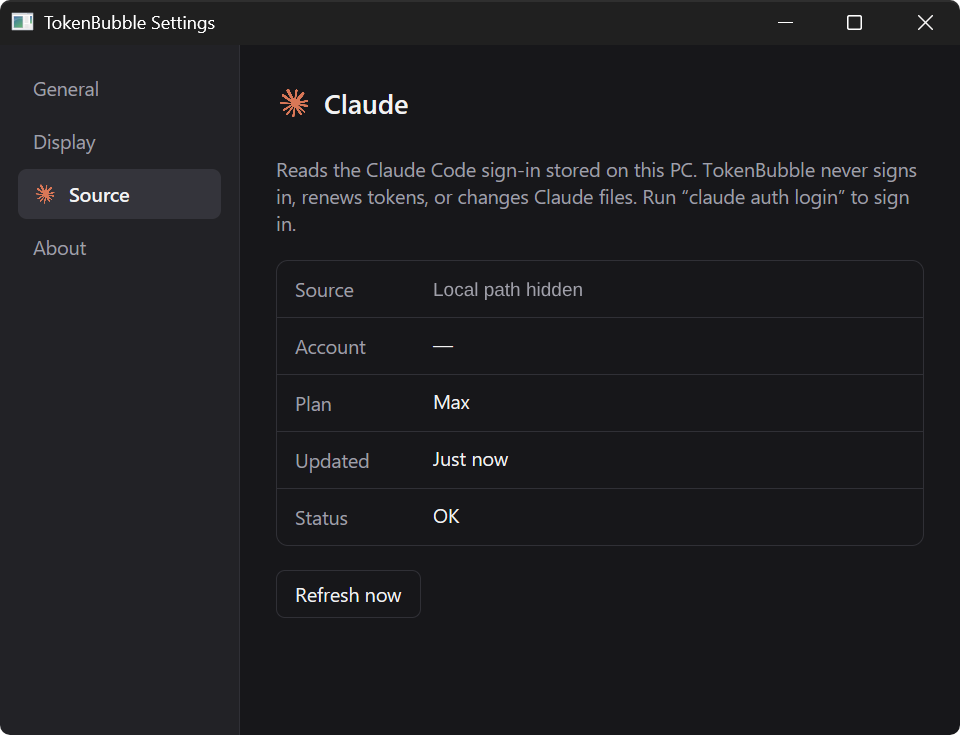
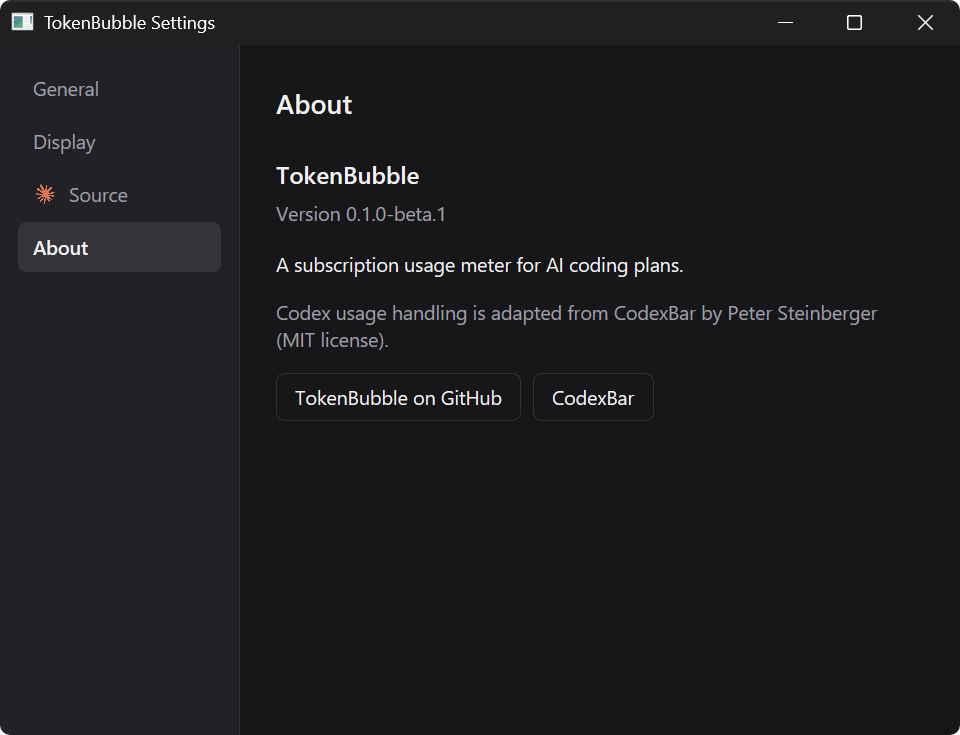

Codex and Claude subscription usage in your Windows tray or Mac menu bar.

[Download for Windows and macOS](https://github.com/cloudboy-jh/tokenbubble/releases)

## Install

### Windows

1. Download the **Windows x64** ZIP and extract it to a permanent folder, such as `%LOCALAPPDATA%\Programs\TokenBubble`.
2. Run `tokenbubble.exe`. Click the bubbles icon near the clock, under **Show hidden icons** if needed.
3. Choose **Codex** or **Claude**. TokenBubble reads that CLI's existing Windows sign-in.

The prerelease is unsigned, so Windows may show a SmartScreen warning. Verify the ZIP against the release's `SHA256SUMS.txt`.

### macOS

1. Download the **macOS arm64** ZIP for Apple Silicon, or **macOS x86_64** for Intel. Requires macOS 13 or newer.
2. Extract it and move `TokenBubble.app` to **Applications**.
3. Open the app and click the bubbles icon in the menu bar. Choose **Codex** or **Claude** to read that CLI's existing Mac sign-in.

The Mac build is ad-hoc signed, not notarized by Apple. Verify `SHA256SUMS.txt` first. If macOS blocks it, open **System Settings → Privacy & Security → Open Anyway** after the first launch attempt.

## Use

- Check session, weekly, and model limits with reset countdowns. **Refresh** fetches a new reading.
- **General:** choose the provider and refresh interval. Windows also supports starting at sign-in; on Mac, add the app through **System Settings → General → Login Items**.
- **Display:** show usage or remaining quota, choose reset formatting, and toggle monetary fields.
- **Source:** inspect the credential location, current plan, freshness, and errors.

TokenBubble does not log in, renew tokens, or copy credentials from WSL. Sign in using the provider's CLI on the same computer. On Mac, Claude can read its existing Claude Code Keychain entry; TokenBubble never writes to it.

## Screenshots

Captured from the Windows app. Account details and local paths are hidden; usage values are real readings.

[Codex panel](docs/screenshots/codex.png) · [Claude panel](docs/screenshots/claude.png) · [1280×640 social card](docs/social-preview.png)

<details>
<summary>General settings</summary>



</details>

<details>
<summary>Display settings</summary>



</details>

<details>
<summary>Source settings</summary>



</details>

<details>
<summary>About</summary>



</details>

## Updates

Quit TokenBubble from its tray or menu-bar menu, replace the executable or `.app` with the new release, and launch it again. Updates are manual.

Settings stay in `%APPDATA%\TokenBubble\settings.toml` on Windows, or `~/Library/Application Support/TokenBubble/settings.toml` on Mac.

## Development

With Rust installed, run this in Windows PowerShell or a Mac terminal:

```powershell
cargo dev
```

To build a release ZIP:

```powershell
powershell -ExecutionPolicy Bypass -File tools/package-windows.ps1
```

On macOS, build an app ZIP with:

```sh
bash tools/package-macos.sh
```
